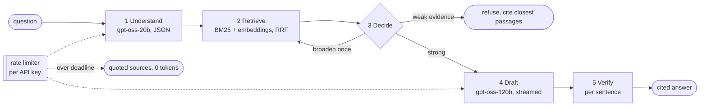

# Relay

Cited answers from research papers, served under a free LLM tier's real rate limits.

Relay answers questions about three arXiv papers: *Attention Is All You Need*, *Moshi* and *Dynamic Chunking (H-Net)*. Every sentence it sends cites the passage it came from, and every number in it has been found in that passage. If the papers don't say, it says so.

The harder part is speed under load. Groq's free tier gives each model 8,000 tokens a minute, and one cited answer costs about 2,150 tokens. That is 3.7 answers a minute. Relay treats that budget as the system's capacity. It decides who waits, who gets fewer passages, and who gets the cited sources immediately instead of a written answer, and it never drops a request silently.

## How it works



1. **Understand.** `gpt-oss-20b` returns JSON: which paper, a search query, and whether the question is in scope.
2. **Retrieve.** This is a tool call with a timeout. It runs a local hybrid of BM25 and `bge-small` embeddings fused with reciprocal rank fusion, with an optional cross-encoder re-rank. It costs no API tokens.
3. **Decide.** Clearly weak evidence is refused before any draft tokens are spent; otherwise one broadened re-query. A paper named in the question always filters retrieval.
4. **Draft.** `gpt-oss-120b` writes from the numbered passages only.
5. **Verify.** A sentence reaches the user only if it has a citation, every number in it appears in the cited passage, and it cites the paper the user asked about.

Around the pipeline:

- **Rate limiter:** one per API key, holding continuously refilling buckets for all four limits (requests and tokens, per minute and per day). Every response header corrects it.
- **Degradation ladder:** when the per-minute budget runs low, retrieval drops to half the passages and routing switches to keyword rules. When a request cannot meet its deadline, it gets exact cited quotes at once. When the daily budget is gone, it moves to the fallback model, then to quotes.
- **Retries:** budgeted, with full jitter. They honour `retry-after`, and a daily 429 is never retried.
- **Admission queue:** coalesces identical questions arriving at the same time.
- **Stand-in:** a Groq-compatible service for load tests. It streams, refuses at limits, slows down under load and fails on cue. Its latency is fitted to 298 real calls.

## Quick start

```bash
uv sync
uv run python -m relay.ingest        # downloads the pinned paper versions, builds the index
uv run python -m relay.standin &     # local Groq-compatible stand-in
uv run python -m relay.app "What frame rate does Mimi run at?"

cp .env.example .env                 # add GROQ_API_KEY to use the real service
uv run python -m relay.app "What frame rate does Mimi run at?" --real
```

## What I measured

All real numbers come from Groq's free tier, using `gpt-oss-120b` and `gpt-oss-20b`. Load shapes beyond what a free key can take ran against the stand-in, set to the measured limits. Every table below is rebuilt from `results/results.csv` by `uv run python -m relay.analysis`.

### Limits, found by hitting them

| Limit | Value | How |
|---|---|---|
| Requests per minute | 30 per model | Not in the headers. Found from the 429 body: "Limit 30, Used 30" |
| Tokens per minute | 8,000 per model, refilling ~133/s | `x-ratelimit-limit-tokens` and a TPM 429 |
| Requests per day | 1,000, refilling 1 per 86.4 s | `x-ratelimit-reset-requests` = n × 86.4 s |
| Tokens per day | 200,000 (20b), refilling continuously | Spent it: daily 429 with `retry-after: 262` = 605 excess tokens × 86,400 / 200,000 |
| In flight at once | no cap seen up to 12 | 1, 4, 8 and 12 simultaneous calls |
| Reserved `max_tokens` | not charged | `max_tokens` 16 and 2000 were both charged 95 tokens |

### Under load

| Scenario | Source | Requests | First token p50 / p95 (ms) | Answered | Cited sources at once | Gave up |
|---|---|---|---|---|---|---|
| Steady | real | 18 | 1,375 / 3,106 | 94.4% | 0% | 5.6% |
| Burst, 12 in 5 s | real | 12 | 2,244 / 13,292 | 58.3% | 25.0% | 16.7% |
| Steady | stand-in | 29 | 1,604 / 3,327 | 100% | 0% | 0% |
| Burst, 100 in 10 s | stand-in | 106 | 2,896 / 13,208 | 15.1% | 39.6% | 45.3% |
| Same burst, cache on | stand-in | 106 | 0 / 3,393 | 64.2% | 17.9% | 17.9% |
| Overload, ~4× capacity | stand-in | 90 | 1,498 / 10,539 | 73.3% | 10.0% | 16.7% |
| Limits halved without notice | stand-in | 22 | 1,531 / 11,223 | 81.8% | 9.1% | 9.1% |
| Daily budget runs out | stand-in | 44 | 1,441 / 9,426 | 36.4% | 63.6% | 0% |

"Gave up" means a simulated user's patience ran out first (lognormal, median 10 s). Full latency and outcome tables, including p99, retries, peak queue and cost per 1,000 answers, come out of `relay.analysis`.

### Retrieval: quality against cost

Measured on real Groq. The test set is 20 questions: 12 the papers answer, and 8 they don't (including cross-paper traps).

| Setting | Correct (of 12) | Wrong (of 20) | Refused correctly (of 8) | Tokens per answer |
|---|---|---|---|---|
| 200-token pieces, 8 fetched | 8 | 4 | 8 | 2,316 |
| **500-token pieces, 4 fetched (default)** | **9** | **2** | **8** | **2,407** |
| 300-token pieces, re-rank 20 → 4 | 7 | 4 | 8 | 1,917 |
| 500-token pieces, 2 fetched (used near the limit) | 8 | 3 | 8 | 1,498 |

The default sends the fewest wrong answers and needs no CPU re-ranker, which costs about 0.9 s and becomes its own queue in a burst. In exchange it spends 26% more tokens than the re-ranked setting. With 12 answerable questions, a difference of two answers is suggestive, not proof.

### Things that surprised me

- **Streaming barely helped.** For 22 of 24 real answers, the last word arrived within 50 ms of the first. `gpt-oss` reasons silently and then sends the whole answer at once, so every gain in time to first token had to come from doing less before the draft.
- **"Per day" is a slow bucket, not a midnight reset.** At 3pm with the budget gone, the next request fits in about 86 seconds. The out-of-budget reply says "minutes", and it quotes the sentence that best answers the question.
- **Naive retries hurt.** Under the same overload, immediate retries (up to 5) made 1.41 extra calls per request and gave 26.7% of users quotes instead of answers, against 16.7% with budgeted retries.
- **The client-side limiter did not win on raw answers.** Server 429s plus budgeted retries delivered 70 answers against the limiter's 66, and 12 of the limiter run's 15 give-ups happened while it waited. It stays because the degradation ladder runs on its view of the budget. Planning against an 8 s deadline instead of 15 s cut give-ups from 15 to 6, at the cost of 6 fewer written answers.
- **The paper contradicts itself.** The Transformer v7 abstract says EN-FR BLEU 41.8, and §6.1 says 41.0.

The full reasoning, with dates and evidence, is in [DECISIONS.md](DECISIONS.md).

## Repository layout

| Path | What |
|---|---|
| `src/relay/ingest.py` | Downloads the pinned paper versions; section-aware, citable chunks |
| `src/relay/retrieval.py` | Hybrid BM25 + dense retrieval, optional cross-encoder re-rank |
| `src/relay/pipeline.py` | Understand → retrieve → decide → draft → verify, with the degradation ladder |
| `src/relay/verify.py` | Per-sentence citation, number and paper checks |
| `src/relay/limiter.py`, `retry.py` | Header-corrected rate limiter; budgeted retries |
| `src/relay/service.py` | Admission queue, coalescing, cache |
| `src/relay/standin.py` | Groq-compatible stand-in model service |
| `src/relay/probes.py`, `calibrate.py` | Measure the real service; fit the stand-in to it |
| `src/relay/loadgen.py` | Open-loop load generator with impatient users (`config/scenarios/*.yaml`) |
| `src/relay/evaluate.py`, `grade.py` | Quality runs per retrieval setting; reviewed grades |
| `src/relay/analysis.py` | Every table, computed from `results/results.csv` |
| `config/default.yaml` | Every tunable: models, limits, retrieval, retries, deadlines |
| `results/`, `raw/`, `eval/` | One row per request, every real call with headers, per-request traces, questions and grades |

## Reproduce

```bash
# measure the real service (small and spend-guarded)
uv run python -m relay.probes latency --n 40 --gap 3
uv run python -m relay.probes rpm --n 40 --window 20 && uv run python -m relay.probes recover
uv run python -m relay.calibrate

# answer quality per retrieval setting (real), then grade
uv run python -m relay.evaluate --real --settings s1_small_many,s2_big_few,s3_rerank,s4_tight
uv run python -m relay.grade propose && uv run python -m relay.grade apply

# load shapes (stand-in running; keep the machine awake: caffeinate -i on macOS)
uv run python -m relay.loadgen config/scenarios/{steady,burst,overload,rpm_halved,day_exhausted}.yaml
uv run python -m relay.loadgen config/scenarios/real_steady.yaml config/scenarios/real_burst.yaml --real

# tables
uv run python -m relay.analysis
```

The API key is read from `.env` and never logged. Real-service runs need an explicit `--real` flag, and probes stop at a per-run token ceiling.

### Notes on the data

- **Keep the machine awake during load runs.** A sleeping laptop pauses the load generator's clock but not the wall-clock rate limits. Each run's summary reports `clock_drift_s`, and a run with drift is invalid (see `raw/invalid_runs_mac_slept.csv`).
- **Set-aside rows are kept in `raw/`, with the reason:**
  - `aborted_real_steady_s3.csv`: the retrieval default changed mid-run;
  - `invalid_runs_mac_slept.csv`: the machine slept;
  - `superseded_day_exhausted_v1.csv`: the reply text improved and the scenario was re-run.
- **Some `eval` rows are ungraded.** Rows with status `rate_limited` are real, but they are limiter fallbacks rather than model answers.
